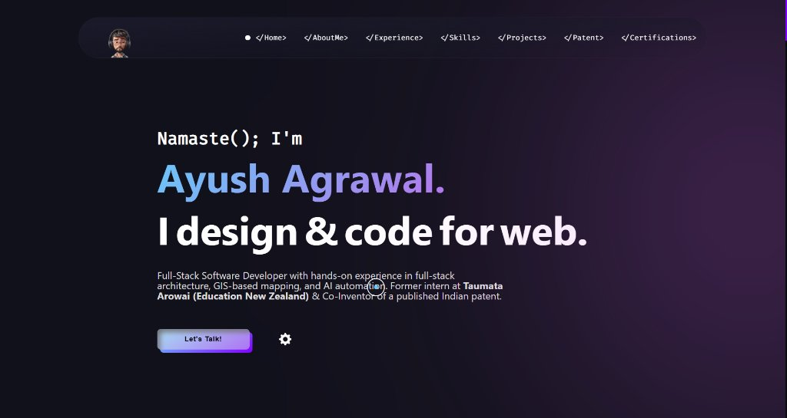

# <a href="https://ayush17514.github.io/ayush17514-portfolio/" target="_blank">Ayush Agrawal | Portfolio</a>

<p align="justify">Modern, high-performance portfolio website showcasing my engineering experience, full-stack projects, published patent, technical certifications, and problem-solving background.</p>



:star: Star me on GitHub — it helps!

## Repository Details 📋

- **Status**: Active & Maintained
- **License**: MIT License
- **GitHub Pages**: [Live Demo](https://ayush17514.github.io/ayush17514-portfolio/)

## Sections 📚

✔️ **Hero / Intro**: Dynamic animated greeting with sound & visual theme toggles  
✔️ **About Me**: Academic background (B.Tech Computer Engineering @ Poornima University, 8 CGPA*), focus areas, and highlight metrics  
✔️ **Work Experience**: Software Engineering Intern at **Taumata Arowai Water Services** (Education New Zealand Manapou ki te Ao)  
✔️ **Skills**: Comprehensive tech stack spanning Languages (Java, JS, TS, Python, C/C++, PHP), Frontend (React, Leaflet, Tailwind), Backend & Databases (REST APIs, MySQL, MongoDB), and Tools (Git, GitHub, Vite)  
✔️ **Projects Showcase**: 
  - **Document Formatter**: AI-powered tool automating 30+ publication standards with Gemini AI  
  - **Prayogam 2025**: Official techfest platform (Lead Developer & Team Leader)  
  - **ManbharJewels**: Dynamic B2C e-commerce platform  
  - **Portfolio Website**: Interactive developer portfolio  
✔️ **Patent & Innovation**: Co-Inventor of officially published Indian Patent (App No. 202511130507)  
✔️ **Certifications & Education**: Microsoft Certified Azure (AZ-900), Google Cloud Cyber Security, MongoDB, JPMorgan Chase Simulation, Hackathon 360° 4.0  
✔️ **Contact & Socials**: Direct links to GitHub, LinkedIn, LeetCode, and Email  

## Features ✨

- Fully responsive design (Desktop, Tablet, Mobile)
- Light / Dark visual theme switch
- Ambient sound & sound toggle
- Interactive custom cursor & animated avatar tracking
- Smooth scrolling navigation with active section scrollspy
- Production-ready GitHub repository links & live views

## Getting Started 🚀

1. Clone the repository:
   ```bash
   git clone https://github.com/Ayush17514/ayush17514-portfolio.git
   ```

2. Open `index.html` in your browser to view the portfolio locally.

3. Deploy to GitHub Pages or any static hosting service.

## Contact 📧

- **Email**: [Ayushagrawal0429@gmail.com](mailto:Ayushagrawal0429@gmail.com)
- **LinkedIn**: [linkedin.com/in/ayush-agrawal0836](http://www.linkedin.com/in/ayush-agrawal0836)
- **GitHub**: [github.com/Ayush17514](https://github.com/Ayush17514)
- **LeetCode**: [leetcode.com/u/Ayush17514/](https://leetcode.com/u/Ayush17514/)

---

*Designed & Built by [Ayush Agrawal](https://github.com/Ayush17514)*
