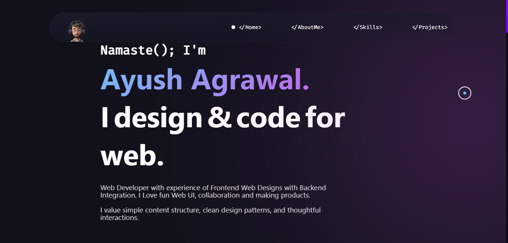

# <a href="https://ayush17514.github.io/ayush17514-portfolio/" target="_blank">My Portfolio</a>

<p align="justify">This website displays my Projects, Web presence, Story, Work experience, and contact information.</p>



:star: Star me on GitHub — it helps!

## Repository Details 📋

- **Status**: Active & Maintained
- **Last Updated**: February 24, 2026
- **License**: MIT License
- **GitHub Pages**: [Live Demo](https://ayush17514.github.io/ayush17514-portfolio/)

## Language Composition 💻

- **CSS**: 65.2%
- **HTML**: 30.6%
- **JavaScript**: 4.2%

## Sections 📚

✔️ Mini intro  
✔️ About me  
✔️ Skills  
✔️ Projects  
✔️ Contact me  

## Features ✨

- Fully responsive design
- Clean and modern UI
- Smooth scrolling navigation
- Project showcase
- Easy contact form

## Getting Started 🚀

1. Clone the repository:
   ```bash
   git clone https://github.com/Ayush17514/ayush17514-portfolio.git
   ```

2. Open `index.html` in your browser to view the portfolio locally

3. Deploy to GitHub Pages or any static hosting service

## Customization 🎨

Feel free to fork this project and customize it to make it your own! Update the content, colors, and projects to showcase your work.

## Contact 📧

Please contact me at **ayushagrawal0426@gmail.com** if you have any feedback for the website.

:star: **Star it, if you like it!**

---

*Made with ❤️ by [Ayush Agrawal](https://github.com/Ayush17514)*
